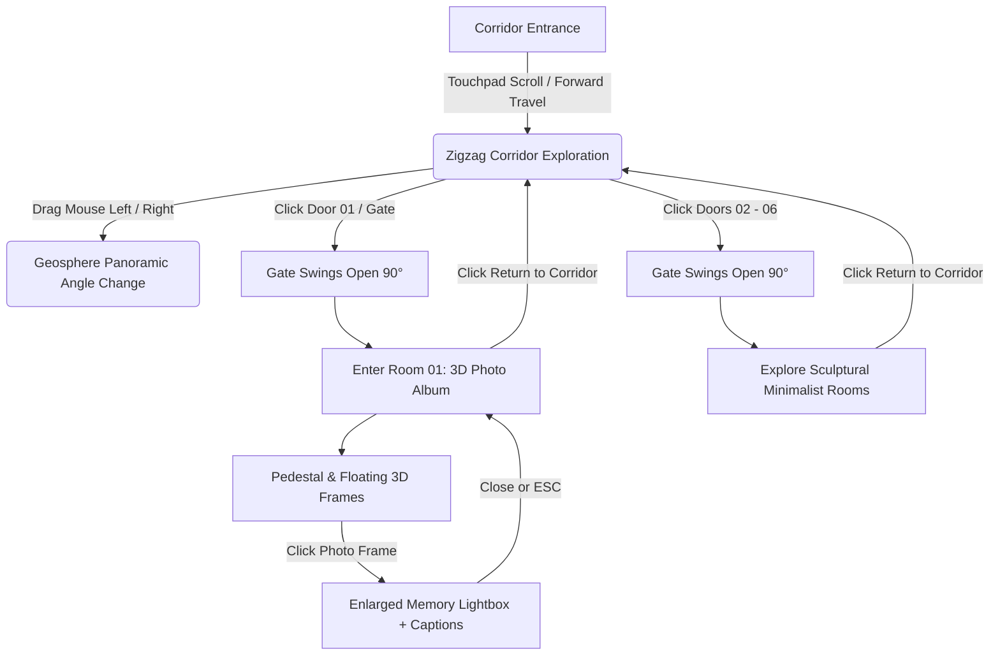

# 🏛️ 3D Interactive Memory House

An immersive, minimalist 3D web experience designed as an architectural gallery house with six interactive rooms arranged in an alternating zigzag corridor layout. Built with **React 19**, **Three.js**, **React Three Fiber**, and **Tailwind CSS**.

---

## 📸 Architecture & Workflow



---

## 🗺️ Zigzag House Floorplan

The corridor connects six independent rooms arranged alternately along the central pathway:

```text
               [CORRIDOR ENTRANCE]
                        │
                        ▼
 ┌──────────────┐                ┌──────────────┐
 │   ROOM 01    │   ◀── (Z = -6) ──▶            │
 │ Photo Album  │   [Left Door]  │              │
 └──────────────┘                │   ROOM 02    │
                                 │ Sound Chamber│
                                 └──────────────┘
 ┌──────────────┐                ┌──────────────┐
 │   ROOM 03    │   ◀── (Z = -18) ─▶            │
 │ Letter Vault │   [Left Door]  │              │
 └──────────────┘                │   ROOM 04    │
                                 │Project Atelier│
                                 └──────────────┘
 ┌──────────────┐                ┌──────────────┐
 │   ROOM 05    │   ◀── (Z = -30) ─▶            │
 │Screening Room│   [Left Door]  │              │
 └──────────────┘                │   ROOM 06    │
                                 │  Sanctuary   │
                                 └──────────────┘
                        │
                        ▼
               [CORRIDOR BALCONY]
```

---

## ✨ Features

- **Minimalist White Architecture**: Pure white concrete, subtle drop shadows, ambient directional lights, and floating glowing room numbers above each doorway.
- **Interactive Swinging Gates**: Every room entrance is fitted with a 3D architectural gate that swings open when clicked, accompanied by realistic opening sound effects.
- **Corridor Scrolling Navigation**: Smoothly walk down the entire hallway from Room 01 all the way to Room 06 via mousewheel / trackpad scrolling.
- **Geosphere Look-Around**: Drag left or right on screen to pan and orbit the camera around the current position like a panoramic sphere.
- **Room 01 — 3D Memory Photo Album**:
  - Centerpiece rotating photo display pedestal.
  - Floating physical frames with realistic bevels, canvas sheen, and soft shadows.
  - Wall gallery featuring framed memories.
  - Interactive lightbox zoom modal with captions, story excerpts, tags, and next/prev photo navigation.
- **Rooms 02 – 06**: Sculpted architectural spaces ready for future custom modules (Audio chamber, letter vault, workshop, cinema, and quiet sanctuary).
- **Soundscape & Audio**: Built-in ambient room hum, door click/swing acoustics, and toggleable mute button.

---

## 🎮 Interaction Controls

| Action | Control |
| :--- | :--- |
| **Move down the corridor** | Scroll down with mouse wheel or two fingers on touchpad |
| **Move backward in corridor** | Scroll up with mouse wheel or touchpad |
| **Look around (Geosphere)** | Click & drag horizontally across the screen |
| **Open Room Gate** | Click on any room's door or the hovering room number |
| **Inspect a Memory** | Click on any floating photo frame inside Room 01 |
| **Exit Room** | Click the **"Back to Corridor"** button or press **ESC** |
| **Toggle Ambient Sound** | Click the speaker icon in the top header |

---

## 📁 Project Structure

```text
├── src/
│   ├── components/
│   │   ├── HouseCanvas.tsx        # 3D canvas setup, lighting, and shadow rig
│   │   ├── HouseEnvironment.tsx   # Architectural walls, floor, ceilings, and lights
│   │   ├── CameraController.tsx   # Scroll travel + geosphere look-around controls
│   │   ├── Room.tsx               # Reusable room unit with swinging gates & room tags
│   │   ├── Room01.tsx             # 3D Photo Album room (pedestal, floating frames)
│   │   ├── EmptyRoom.tsx          # Minimalist static room models for rooms 02-06
│   │   ├── PhotoModal.tsx         # Memory detail lightbox overlay
│   │   └── UIOverlay.tsx          # Floating HUD, room badges, and audio controls
│   ├── data/
│   │   └── albumData.ts           # Photo items, memories, descriptions, and tags
│   ├── utils/
│   │   └── soundEffects.ts        # Synthesized web audio effects (gates, clicks)
│   ├── App.tsx                    # Top-level state and room transitions
│   └── main.tsx                   # React root mount
├── index.html
├── package.json
└── vite.config.ts
```

---

## 🚀 Getting Started

### Prerequisites
- Node.js 18+ installed on your machine.
- npm or pnpm or yarn.

### Installation

1. **Clone the repository**:
   ```bash
   git clone https://github.com/Barathan2006/sample-.git
   cd sample-
   ```

2. **Install dependencies**:
   ```bash
   npm install
   ```

3. **Start the local development server**:
   ```bash
   npm run dev
   ```

4. **Build for production**:
   ```bash
   npm run build
   ```

---

## 🎨 Customizing Memories & Photos

To add your own photos and descriptions into Room 01, open `src/data/albumData.ts` and modify or extend the `ALBUM_PHOTOS` list:

```typescript
export interface PhotoMemory {
  id: string;
  url: string;        // Local file path (e.g., /assets/photo.jpg) or HTTPS URL
  title: string;      // Title of the memory
  description: string;// Story or caption
  date: string;       // Timestamp or year
  location: string;   // Location tag
}
```

---

## 📄 License

This project is open source and available under the [MIT License](LICENSE).
